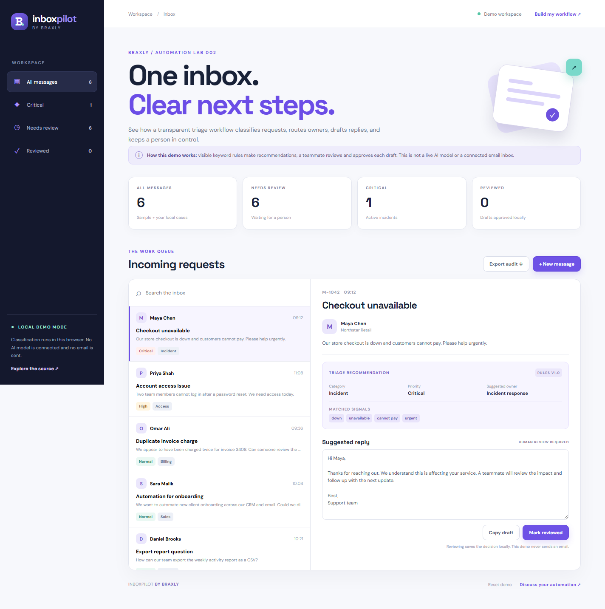

# InboxPilot

A hands-on inbox triage demo from [Braxly](https://github.com/braxlyco). Explore how a request can be classified, prioritized, routed, drafted, and reviewed with a visible audit record.

**[Try the live demo](https://braxlyco.github.io/inboxpilot/)**



## What you can do

- Browse six fictional support and sales messages or add your own case.
- Filter by critical, needs review, and reviewed; search across message content.
- See which keyword signals led to each category, priority, and owner.
- Edit a suggested reply and mark it reviewed. Decisions stay in browser storage.
- Export the local inbox, recommendations, drafts, and review timestamps as JSON.

## Demo boundary

This is a **local, rule-based workflow prototype**. It does not access a real inbox, call an AI model, send email, or transmit your sample cases. Reply drafts are templates for a person to review. Production use would need authentication, a server-side mail integration, permissions, logs, and a tested model policy where AI is appropriate.

## Run locally

Serve this directory with a static file server:

```bash
python -m http.server 5174
```

Open <http://localhost:5174>. Run the decision-rule tests with Node.js 24:

```bash
npm test
```

No dependencies, API keys, or build step are required.

## Structure

```text
index.html       App shell and message form
styles.css       Responsive inbox interface
src/triage.js    Sample data, rule-based routing, and summary logic
src/app.js       Local inbox, drafts, review, filters, and export
tests/           Routing and summary tests
```

For a real inbox automation project, contact [contactbraxly@gmail.com](mailto:contactbraxly@gmail.com).

MIT licensed. See [LICENSE](LICENSE).
